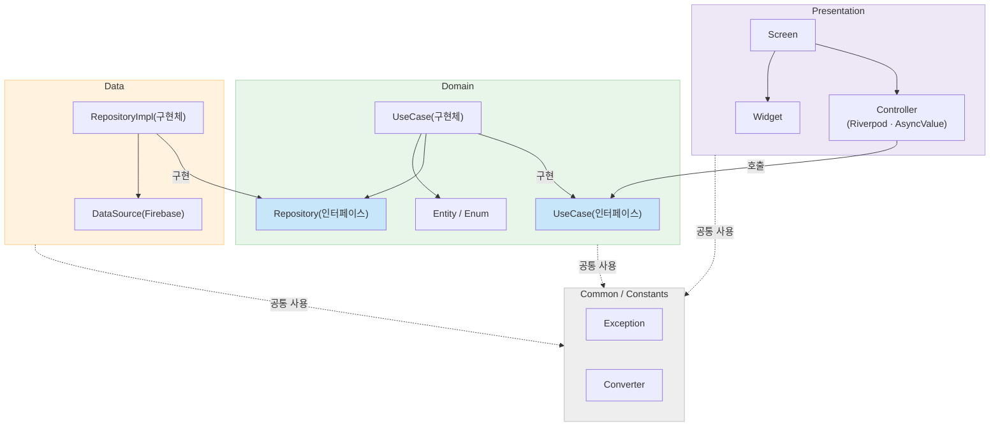
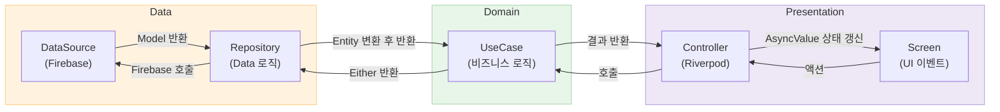
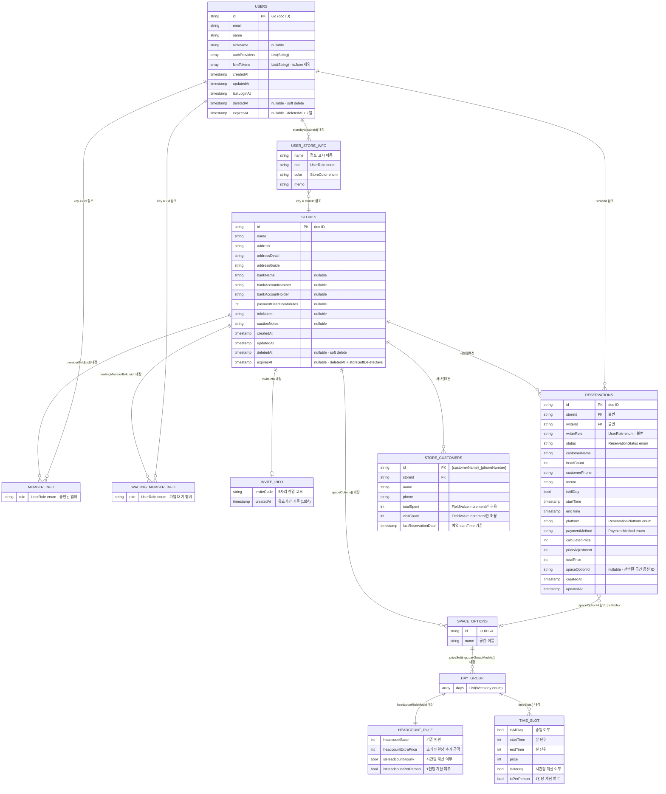

# SpaceManager
> 공간대여업 점포의 예약을 간편하게 관리하는 크로스플랫폼(iOS, Android) 앱입니다.
>
> [Figma](https://www.figma.com/design/k9iL4QL7DsR93RoyoqHrkU/studio-chance?node-id=0-1&t=cOvS5HBllgn6Uxjm-1)
>
> 개발 기간: 2025.12.10 ~

<br>

## 👥 대상 사용자
- 스튜디오, 연습실, 파티룸 등 공간대여 점포를 운영하는 사람
- 여러 점포를 한 곳에서 관리하고 싶은 사람
- 직원과 함께 예약 현황을 공유하고 싶은 사람

<br><br>

## 🛠️ 기술 스택

|    범위    | 기술 이름                                                                                                            |
| :------: | :--------------------------------------------------------------------------------------------------------------- |
|   아키텍처   | `Clean Architecture`, `MVVM`                                                                                     |
| 디자인 시스템  | `Material 3`                                                                                                     |
|  상태 관리   | `Riverpod` (코드 생성)                                                                                               |
|  네비게이션   | `GoRouter`                                                                                                       |
|  불변 객체   | `Freezed`                                                                                                        |
|  에러 처리   | `fpdart` (Either 패턴)                                                                                             |
| Firebase | `Firestore`, `Authentication`, `Crashlytics`, `Cloud Messaging`, `Analytics`, `App Check`, `Firebase AI(Gemini)` |
|  소셜 로그인  | `Google Sign-In`, `Apple Sign-In`                                                                                |
|  내부 저장소  | `SharedPreferences`                                                                                              |
|    로깅    | `logger`                                                                                                         |
|   테스트    | `flutter_test`, `mocktail`, `fake_cloud_firestore`                                                               |
| 형상 관리 도구 | `Git`, `GitHub`                                                                                                  |

<br><br>

## 🔨 개발 환경


%20~-%233DDC84?logo=android&logoColor=white)

<br><br>

## 📊 아키텍처

### 레이어 구조



### 데이터 흐름



---

<br>

## 🗄️ Firestore ERD

### 컬렉션 구조

```
Firestore
├── users/{uid}                                               ← 최상위 컬렉션
│   └── storeById: { [storeId]: UserStoreInfo }               ← 내장 맵
└── stores/{storeId}                                          ← 최상위 컬렉션
    ├── memberById: { [uid]: StoreMemberInfo }                 ← 내장 맵 (승인된 멤버)
    ├── waitingMemberById: { [uid]: StoreMemberInfo }          ← 내장 맵 (가입 대기)
    ├── inviteInfo: InviteInfo?                                ← 내장 객체 (nullable)
    ├── spaceOptions[]: SpaceOption                           ← 내장 배열 (공간 옵션)
    │   └── priceSettings                                      ← 내장 객체 (공간별 요금 설정)
    │       └── dayGroupModels[]: DayGroup                    ← 내장 배열
    │           ├── headcountRuleModel: HeadcountRule          ← 내장 객체
    │           └── timeSlots[]: TimeSlot                     ← 내장 배열
    ├── reservations/{reservationId}                          ← 서브컬렉션
    └── storeCustomers/{customerName}_{phoneNumber}            ← 서브컬렉션
```

### ERD

> **범례**
> - 실선 관계 (`내장`): 동일 문서에 포함된 중첩 객체/맵
> - 점선 참조 (`참조`): 다른 문서의 ID를 키 또는 필드로 저장




---

<br>

## 📱 주요 기능

1. **소셜 로그인**  
   Google 및 Apple 계정으로 간편하게 로그인할 수 있습니다.

<br><br>

2. **3일 캘린더 예약 현황**  
   3일 단위 타임 그리드로 예약 현황을 실시간으로 확인합니다. 종일 예약은 상단 행, 시간대 예약은 해당 시간 셀에 표시되며 Firestore 실시간 구독으로 즉시 반영됩니다.

<br><br>

3. **월간 캘린더**  
   홈 상단의 월간 캘린더로 날짜를 빠르게 이동할 수 있습니다. 날짜를 탭하면 3일 캘린더가 해당 날짜로 이동합니다.

<br><br>

4. **예약 등록 · 수정 · 삭제**  
   고객명, 연락처, 시간, 공간, 결제 방법 등 예약 정보를 입력하고 관리합니다. 점포의 요금 설정에 따라 금액이 자동 계산되며, 메모와 금액 조정도 지원합니다.

<br><br>

5. **예약 스크린샷 OCR (AI 자동 입력)**  
   예약 스크린샷 이미지를 업로드하면 Firebase AI(Gemini)가 고객명, 연락처, 예약 시간을 자동으로 인식해 입력 폼에 채워줍니다.

<br><br>

6. **점포 등록 및 설정**  
   점포 이름, 주소, 계좌 정보, 안내사항 등 기본 정보를 등록합니다. 공간 옵션별로 요일 그룹·시간대·인원 기준을 세분화한 요금 설정을 구성할 수 있습니다.

<br><br>

7. **멤버 초대 및 권한 관리**  
   초대 코드(6자리, 15분 유효)를 생성해 직원·스태프를 초대합니다. 관리자는 가입 대기 멤버를 승인하고 역할(Admin/Staff/Viewer)을 변경할 수 있습니다.

<br><br>

8. **다중 점포 관리**  
   여러 점포를 하나의 앱에서 관리합니다. 점포별 색상으로 구분하고 필터로 원하는 점포의 예약만 표시할 수 있습니다.

<br><br>
